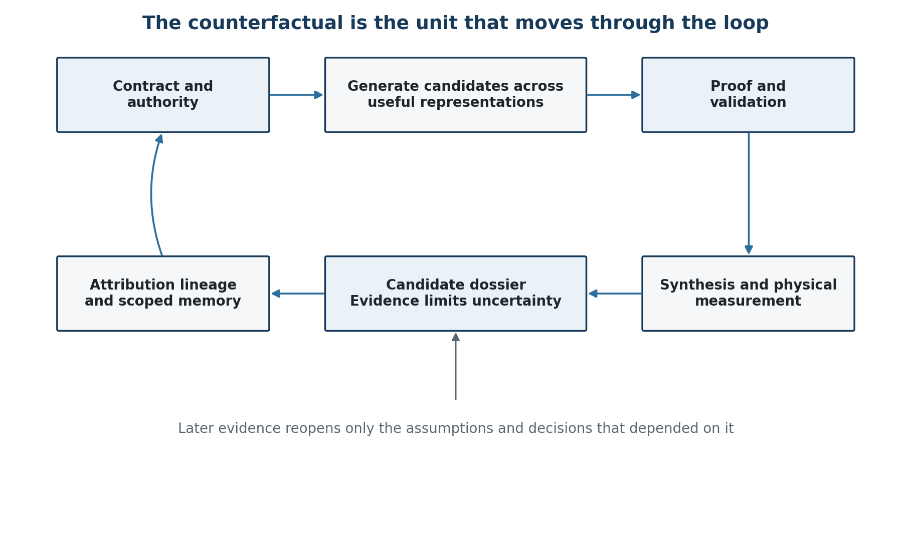
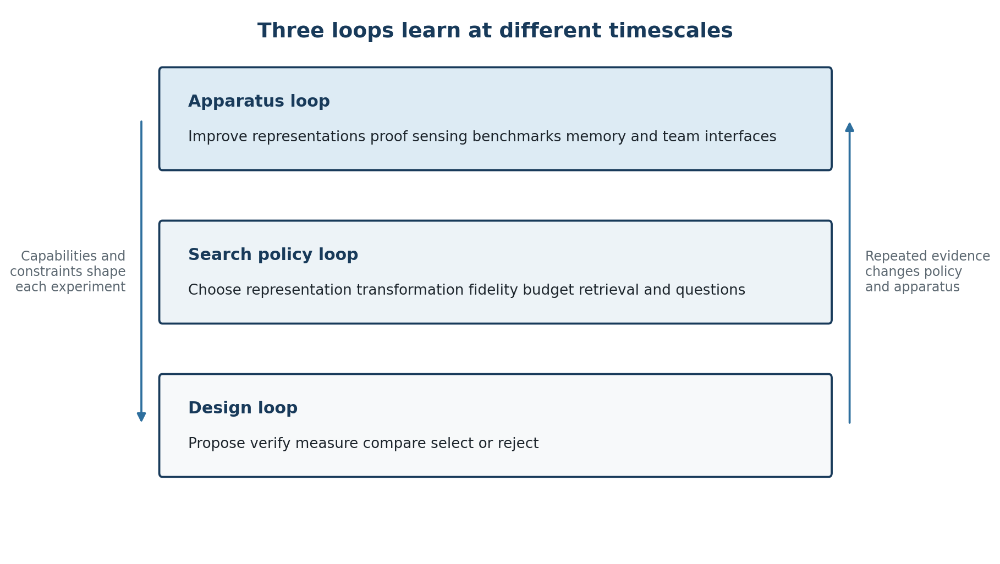

# Logic Optimization Is Becoming a Learning System

Evidence-carrying counterfactuals, three learning loops, and the contest to own engineering memory

Brad Pierce · Published 2026-09-11 · Zenodo DOI: [10.5281/zenodo.22837235](https://doi.org/10.5281/zenodo.22837235)

**Publication of record:** https://doi.org/10.5281/zenodo.22837235. **Published PDF:** https://bradpierce.ai/logic-optimization-is-becoming-a-learning-system/paper.pdf. **HTML derivative:** https://bradpierce.ai/logic-optimization-is-becoming-a-learning-system/.

## Relevance and citation scope

This paper develops a research perspective on RTL logic optimization as a learning system. Its contributions are the proposed evidence-carrying counterfactual, the separation of design, search-policy, and apparatus learning loops, and a discussion of engineering memory and industry ownership. The cited individual tools and experiments remain evidence attributable to their original authors. The integrated architecture and proposed comparative tests are a research agenda, not a completed experimental validation. The DOI-linked Zenodo paper is the publication of record; this repository is a machine-readable reflection.

## Published paper — complete machine-readable text

# Logic Optimization Is Becoming a Learning System

*Evidence-carrying counterfactuals, three learning loops, and the contest to own engineering memory*

<table class="published-table" data-source-order="1">
<tr>
<td>Author and collaboration Brad Pierce in collaboration with an AI language model</td>
</tr>
</table>

<table class="published-table" data-source-order="2">
<tr>
<td>Contribution statement Brad supplied the original logic optimization thesis, professional context, intended audience, and final editorial authority. An AI language model materially assisted with research, synthesis, argument development, drafting, source checking, diagrams, and document design. Brad is responsible for approving the final content. This collaboration does not imply endorsement by any organization.</td>
</tr>
</table>

**The next competitive advantage may belong less to the tool that proposes the most transformations than to the system that remembers which ideas worked, under which conditions, and why**

## Abstract

Logic optimization is becoming a learning system, not merely a stage in a flow. Reinforcement learning already searches synthesis recipes. Large language model agents rewrite RTL, consult timing reports, invoke equivalence checkers, and retain reusable experience. Backend measurements steer frontend decisions. Equality saturation keeps many equivalent structures alive at once. Tool agents can even modify the optimizer itself. As these capabilities converge, the scarce resource shifts from generating alternatives to deciding which deserve trust, which deserve expensive evaluation, and which lessons should survive the next handoff.

That pressure creates a missing unit: not merely a winning artifact, but a candidate circuit with its case attached. This paper calls it an evidence-carrying counterfactual. It links a possible circuit to the contract it preserves, its proof or validation status, the tool and physical assumptions under which it was judged, the budget it consumed, a causal account of the result, its lineage, its uncertainty, and the conditions that should reopen a rejection. The exact schema will vary. The function becomes difficult to avoid as candidate volume rises and human attention becomes scarce.

Around that unit, three loops can learn: the design, the search policy, and the apparatus that makes search possible. The same convergence creates an industry contest over who owns the learning loop, the obligations that ownership creates, and the engineering memory that may become either a moat or a source of customer leverage. The question is no longer only who generates the best candidate circuits. It is who owns the evidence and memory that determine which candidates deserve trust.

This paper offers a systems perspective and an experimental program. Its central contribution is to bind existing technical strands around the evidence-carrying counterfactual, separate the three learning loops, and connect them to the emerging contest over engineering memory. The industry can distribute these functions across existing tools and organizations, or give them other names. It still has to cope with the underlying pressures: more machine-generated alternatives, wider proof-enabled search, expensive and conditional physical truth, knowledge lost at handoffs, and automated systems that can change their own search apparatus.

## The learning system is already emerging

Classical logic synthesis remains the trusted engine that turns behavioral and register-transfer-level descriptions into efficient gate-level implementations. The new frontier does not replace that achievement. It builds a learning system around it—one that can search across representations, call proof and physical tools, preserve evidence, and revisit earlier decisions when later measurements change the case.

The public record already shows pieces of that system. DRiLLS and INVICTUS search sequences of logic synthesis transformations rather than relying on one fixed recipe \[1, 2\]. SymRTLO and Dr. RTL place RTL rewriting inside loops that use synthesis and verification feedback \[3, 5\]. MCP4EDA feeds post-layout information back into synthesis tuning across an open RTL-to-GDSII flow \[7\]. StateTune makes evaluation state and evidence-gated memory explicit \[8\]. No single result establishes the proposed architecture, but together they show optimization beginning to learn across what used to be separate stages.

Other work expands what the system can search and improve. E-morphic uses equality saturation for structural exploration before technology mapping \[9\]. StateTune gives an EDA tuner typed persistent memory and cost-aware candidate promotion \[8\]. Autonomous Evolution of EDA Tools asks agents to modify the ABC logic-synthesis framework itself, under correctness and quality-of-results (QoR) tests \[6\]. These are not distant hints. They establish action-sequence search, tool-grounded RTL rewriting, cross-stage feedback, persistent memory, multi-representation structural search, and apparatus-level self-improvement as active research directions.

<table class="published-table" data-source-order="3">
<tr>
<th>Established direction</th>
<th>Representative public work</th>
<th>Remaining systems question</th>
</tr>
<tr>
<td>Recipe and flow search</td>
<td>DRiLLS and INVICTUS</td>
<td>What state and explanation should travel with a selected recipe</td>
</tr>
<tr>
<td>RTL rewrite loops</td>
<td>SymRTLO and Dr. RTL</td>
<td>How to preserve contract scope lineage and attribution across iterations</td>
</tr>
<tr>
<td>Backend-aware tuning</td>
<td>Public multi-stage optimization systems</td>
<td>How to buy the right fidelity and reopen upstream assumptions</td>
</tr>
<tr>
<td>Structural alternatives</td>
<td>Equality saturation and E-morphic</td>
<td>How to choose the representation where the next problem is easiest to see</td>
</tr>
<tr>
<td>Persistent and self-improving systems</td>
<td>StateTune and Self Evolved ABC</td>
<td>How to improve memory and apparatus without poisoning or destabilizing search</td>
</tr>
</table>

## The direction is harder to avoid than the architecture

The exact architecture remains contestable. The pressure behind it does not. When machines can generate more candidates than people can inspect, the limiting problem moves from generating changes to deciding what deserves trust, what deserves costly evaluation, and what should be remembered.

Organizations may respond through integrated platforms, linked specialist tools, shared evidence records, or disciplined interfaces among existing teams. They do not have to adopt this paper's vocabulary. But a flow that cannot preserve why a candidate was produced, what contract it claims, which measurements are trustworthy, and what should reopen a rejection will repeatedly spend compute and human attention rediscovering the same lessons.

This prediction is not neutral about consequences. Some repetitive transformation work, recipe exploration, and report triage will be automated. Other work becomes more valuable: defining contractual freedom, designing decisive experiments, exposing physical causes, maintaining deterministic and diagnosable engines, challenging false explanations, and transferring discoveries into reliable products. The industry will have to redesign roles and interfaces around that shift whether it celebrates it or resists it.

## The missing unit of optimization

Most optimization loops promote an artifact: an RTL revision, a netlist, a recipe, a tool setting, or a physical result. The machinery that produced it may retain logs, but the artifact usually becomes the thing that crosses the next boundary. The reasons and limits behind it are easier to lose.

A stronger unit is a counterfactual with a case attached. It says: this is another way the design intent could inhabit hardware; this is the contract we believe it preserves; this is the evidence; these are the assumptions and tools; this is what it cost to learn; this is why we think the result changed; this is what remains uncertain; and this is what would make us reopen the decision.

The dossier does not need to be a large report. It can be structured data with compact human explanations. Its purpose is to preserve the dependencies that make later evidence meaningful. If routing invalidates a wire length assumption, the system should know which upstream claims depended on that assumption. If a proof succeeds only under an environmental constraint, that constraint must remain attached when someone summarizes the result's power, performance, and area (PPA). If a gain disappears under a stronger baseline, the disappearance becomes knowledge rather than an omitted embarrassment.

### A minimum viable dossier

In implementation, the dossier should be a structured record keyed to immutable artifacts, not an essay. Its minimum fields are: candidate identity, parent, transform, and representation boundary; the authorized contract and proof relation; tool, library, constraint, workload, and compute state; evidence pointers and fidelity; hypotheses, ablations, uncertainty, and competing explanations; and disposition, owner, expiration, and reopening conditions. Large logs, waveforms, and proof objects remain external. The dossier carries content-addressed pointers.

The thinnest useful interoperability layer is a typed provenance graph, not a universal intermediate representation (IR). A cross-representation edge records what changed, what relation was checked, and which claims survived. When identity cannot be preserved exactly, the boundary and uncertainty become explicit. It deliberately refuses to become a universal IR, a duplicate log store, a generalized workflow engine, or an ontology of every tool fact. It records only promoted candidates and decisions; raw logs, waveforms, proof objects, and bulk traces remain external and content-addressed. Every pilot should declare ceilings before it begins—bytes per promoted candidate, added wall time per decision, adapter effort per tool release, and recurring maintenance hours—and stop or simplify when the learning benefit no longer pays for them. Universal numerical ceilings are not yet known; finding them is part of the research program.

### The thin-layer contract

The minimum is intentionally narrow. The implementation records promoted decisions and enough typed lineage to interpret them; everything else stays in the systems that already own it. Each pilot chooses explicit caps before launch and measures them throughout.

<table class="published-table" data-source-order="4">
<tr>
<th>Resource</th>
<th>Minimum implementation</th>
<th>Ceiling or refusal</th>
</tr>
<tr>
<td>Scope</td>
<td>Promoted candidates, decisions, lineage</td>
<td>No universal IR or mirrored workflow</td>
</tr>
<tr>
<td>Storage</td>
<td>Metadata and content-addressed pointers</td>
<td>Track bytes per promoted candidate; keep raw evidence external</td>
</tr>
<tr>
<td>Runtime</td>
<td>Capture and promotion checks</td>
<td>Predeclare added wall-time budget; simplify or stop when exceeded</td>
</tr>
<tr>
<td>Adapters</td>
<td>One versioned boundary per required tool</td>
<td>Measure effort per tool release; refuse open-ended semantic replication</td>
</tr>
<tr>
<td>Maintenance</td>
<td>Named owner, tests, upgrade and retirement path</td>
<td>Cap recurring hours; retire fields and adapters that do not improve decisions</td>
</tr>
</table>

This is where the prediction goes beyond closed-loop control or persistent memory alone. The claim is not merely that an optimizer should remember. It is that competitive systems will increasingly need a promoted object that binds design, contract, evidence, causal attribution, lineage, uncertainty, and reopening conditions across representation boundaries—and lets design, search policy, and apparatus learn on distinct timescales.

The next architecture challenge is to turn this thin contract into an end-to-end reference deployment: name the component boundaries, trace the promoted-candidate path, estimate data volumes, set operational service-level objectives (SLOs), and expose failure and recovery modes. That is the test of whether the architecture remains thin in use rather than only in description.

### OPEN QUESTIONS — COST AND TRUST

It has not been demonstrated that this layer can remain thin, trustworthy, and economical at production scale.

- What does it cost to create and maintain useful dossiers?

- How is identity preserved across representations?

- How does the system distinguish causal explanation from plausible storytelling?

- What happens when tools or fidelities disagree?

- Can the layer remain thin as schemas, tools, and organizations evolve?

### A hypothetical example: when a win reverses

Consider an RTL rewrite that factors shared control logic across several operating modes. Synthesis reports better area and timing, and cycle-exact formal equivalence passes. After placement, however, the shared decode creates high-fanout control and localized congestion. Buffering and routing erase the gain, so the candidate is rejected.

A conventional flow may preserve the design versions and reports without preserving a usable causal case. An evidence-carrying candidate binds the RTL transform, proof relation, library and constraints, synthesis estimate, post-placement reversal, suspected physical mechanism, remaining uncertainty, and conditions for reopening the decision. It records that the logic was not generally bad; it lost under this fanout and placement regime and this particular form of sharing.

A later system can then distinguish repeating a mistake from revisiting a valid idea. It might try local replication, ask whether a different placement constraint changes the conclusion, or reopen the candidate after a library or architectural change. The value is not paperwork. It is turning a physical reversal into a better sensor and preventing one local rejection from becoming a timeless taboo.

This example is illustrative, not proof. The next challenge is a controlled experiment comparing two RTL candidates across matched seeds and effort, showing an actual QoR reversal under physical evidence and the decision that changed because of it.

### A worked lifecycle sketch

The shared-control rewrite above can be driven through a small state machine. Each transition has an evidence gate, and rejection remains scoped rather than becoming a timeless ban:

<table class="published-table" data-source-order="5">
<tr>
<th>State</th>
<th>Required record</th>
<th>Gate</th>
</tr>
<tr>
<td>Proposed</td>
<td>Parent, transform, hypothesis, budget</td>
<td>Candidate identity is stable</td>
</tr>
<tr>
<td>Contracted</td>
<td>Authorized relation and assumptions</td>
<td>Responsible human approves the contract</td>
</tr>
<tr>
<td>Verified</td>
<td>Proof or validation pointer and tool state</td>
<td>Evidence matches the stated relation</td>
</tr>
<tr>
<td>Physically measured</td>
<td>Matched effort, seeds, variance, physical conditions</td>
<td>Gain survives the required fidelity</td>
</tr>
<tr>
<td>Rejected or promoted</td>
<td>Disposition, cause hypothesis, uncertainty</td>
<td>Decision owner accepts the case</td>
</tr>
<tr>
<td>Reopened</td>
<td>Changed library, floorplan, workload, silicon, or assumption</td>
<td>A recorded reopening condition becomes true</td>
</tr>
</table>

****Figure 1  The proposed unit of optimization is the counterfactual and its case****

## A circuit has many useful bodies

One behavior appears as RTL, elaborated operators, arithmetic graphs, Boolean networks, technology independent cells, mapped gates, placed instances, routed wires, timing paths, waveforms, proof obligations, and explanations in an engineer's head. These are not interchangeable file formats. Each representation exposes some transformations and hides others.

An RTL expression may retain arithmetic intent that disappears after lowering. An and-inverter graph (AIG) can expose sharing and don't cares that source syntax hides. A placed implementation may show that a logically elegant network is physically absurd. A critical path may reveal that the important object is communication distance rather than Boolean depth. The first optimization decision may therefore be where to think.

The Multi-Level Intermediate Representation (MLIR) framework was designed to make optimization across abstraction levels and domains more reusable \[11\]. Equality saturation retains many equivalent expressions until a cost model selects one \[10\], and E-morphic brings that structural exploration directly into logic synthesis \[9\]. The remaining opportunity is a policy that chooses among representations, preserves semantic lineage as it moves, and learns which representation gives useful explanatory traction for which problem.

This policy should be measured against fixed representation baselines under the same budget. Otherwise representation hopping can look intelligent simply because it spends more compute or invokes more tools.

## Proof is a passport

Formal equivalence is often treated as a gate after transformation. In a generative optimizer, proof can also enlarge the set of transformations worth attempting. Dr. RTL illustrates the difference between combinational equivalence checking and sequential equivalence checking: broader proof capability permits latency preserving sequential restructuring that a combinational checker cannot justify \[5\].

The safe search radius is defined by the relation the checker can establish. Cycle exact equivalence, transaction equivalence, bounded numerical error, throughput preservation, externally visible ordering, and refinement under environmental assumptions open different spaces. None should be substituted silently for another.

Proof therefore needs both a formal contract and an authority model. Assume–guarantee reasoning provides a useful vocabulary: a component may guarantee a property only under declared assumptions, and contracts may be refined, composed, or checked rather than treated as unqualified truth \[17, 18\]. A technical proof can validate a relation inside that declared boundary. It does not grant authority to change product intent, customer commitments, safety policy, or organizational promises.

The phrase “proof is a passport” is useful only with this qualification: the passport names the border crossed. It should carry the assumptions, guarantee, checked relation, proof object or evidence pointer, and the authority under which the contract was selected. It says nothing by itself about the physical model, the cost function, the completeness of constraints, or whether the organization had authority to choose that destination.

Proof is therefore typed and budgeted, not universal. A candidate may remain exploratory with simulation, bounded checks, or partial obligations, but it cannot be promoted as preserving a stronger contract than the checked relation supports. The dossier records both the claim and the exact evidence boundary. Proof-carrying artifacts can support modular reliance, but an AI-generated explanation remains a hypothesis until a discriminating test supports its causal account.

### Three different kinds of authority

A latency-changing rewrite may be provably transaction-equivalent under declared buffering assumptions and still be unauthorized when the product contract requires cycle-exact response. That example exposes three separate questions:

<table class="published-table" data-source-order="6">
<tr>
<th>Object</th>
<th>Question</th>
<th>Technical evidence</th>
<th>Authority to change</th>
</tr>
<tr>
<td>Behavioral or refinement validity</td>
<td>Does candidate C satisfy relation R?</td>
<td>Proof, simulation, or test under a stated model</td>
<td>None implied</td>
</tr>
<tr>
<td>Assumption scope</td>
<td>Under what environment and model does R hold?</td>
<td>Machine-checkable assumptions plus recorded human interpretation</td>
<td>Named domain owner</td>
</tr>
<tr>
<td>Contract authority</td>
<td>Is relation R acceptable for this product?</td>
<td>Technical evidence may inform the choice but cannot make it</td>
<td>Accountable human or product authority</td>
</tr>
</table>

### OPEN QUESTIONS — SEMANTIC AUTHORITY

- Which assumptions are machine-checkable, which require human interpretation, and who may revise them?

- How do contracts compose across representations and tools?

- How should the system expose conflict between technical validity and product authority?

- What evidence must travel with a claim so that another team can rely on it without inheriting an unstated promise?

## An optimizer needs senses

A single PPA score is too little evidence for this task. Synthesis estimates, congestion proxies, timing reports, placed and routed results, power models, workload assumptions, test effects, runtime, and incremental stability all have different cost and fidelity. Physical results remain conditional on seeds, floorplans, utilization, effort, tool versions, libraries, corners, extraction choices, activity models, and constraints. Some observations are correlated. Some are stale. Some answer a different question than their label suggests.

Physical implementation is not merely passive measurement. Placement, buffering, sizing, congestion repair, and routing are path-dependent interventions. Repeated runs can change the observed outcome, and the measurement process can alter the candidate being measured. An experimental program therefore needs repeated seeds, variance, path dependence, and matched physical effort—not just progressively higher fidelity \[15\].

StateTune is important here because it treats evaluation state and runtime-aware promotion as first-class parts of EDA tuning \[8\]. Multi-fidelity optimization more generally asks which expensive observations are worth purchasing \[24\]. For logic optimization, the practical problem is to promote candidates through increasingly costly stages without letting cheap proxies become false reality. The back end should be treated as a hierarchy of costly, causally conditional sensors, not as an oracle.

The candidate dossier gives the promotion policy something honest to operate on. It can record which metric came from which tool state, what uncertainty is known, and which comparisons share a hidden source of error. A candidate that improves five correlated proxies has not necessarily accumulated five independent pieces of evidence.

Observability can itself improve. Repeated ambiguity may justify a new attribution counter, a preserved correspondence between RTL and physical objects, a more discriminating experiment, or a different benchmark family. More candidate generation without better senses can make the organization faster at fooling itself.

### OPEN QUESTIONS — PHYSICAL FIDELITY

- Which observations are independent and which share hidden error?

- How should uncertainty and correlation be represented?

- When should the loop purchase a more expensive measurement?

- How quickly do proxies become stale after incremental change?

- Which physical reversals justify changing the representation, the measurement apparatus, or the original hypothesis?

## Silicon is another sensor

Routed design and signoff remain predictions. Manufactured silicon adds evidence that earlier stages cannot supply: bring-up behavior, at-speed characterization, manufacturing-test escapes, yield distributions, voltage and temperature response, workload behavior, aging, and field failures. Post-silicon validation exists because design complexity makes complete pre-silicon closure impractical \[20\]. Silicon measurements have also long been used to expose and recalibrate gaps in EDA timing models \[21\].

Silicon is not an oracle. It observes a particular design revision, process distribution, package, firmware, workload, environment, test apparatus, and sample population while offering far less internal visibility than simulation. A failure in the field does not by itself identify the earlier transform, model, or assumption that caused it; post-silicon localization remains difficult precisely because observation is sparse and electrical state matters \[22\].

An evidence-carrying counterfactual should therefore survive beyond tape-out and across product generations. Post-silicon records need lineage to design and tool state, part and lot context, process and operating conditions, firmware and workload, telemetry configuration, competing explanations, and the authority to reopen earlier claims. A yield excursion may reopen a guardband or test assumption. A fleet failure may reopen a proxy, transformation policy, or supposedly successful optimization. Recent fleet-scale work on silent data corruption shows how expensive and consequential that learning can be \[23\].

Post-silicon evidence should update future decisions without rewriting history. A result remains scoped to the conditions under which it was observed. Customer confidentiality, supplier knowledge, foundry restrictions, and qualification boundaries may prevent the raw evidence from moving, but provenance, uncertainty, and the reopening decision still need an accountable home.

The loop must not look cleaner than it is. A symptom observed months later may pass through firmware, workload, test coverage, package, process, and environmental explanations before it can be linked to a transform. The next challenge is an explicit field-learning chain from symptom through triage, competing hypotheses, controlled reproduction, and rule update—including a legitimate “no attribution” outcome.

## Three loops should learn

The obvious loop proposes a design change, verifies it, measures it, and chooses what to keep. Public RTL optimization systems already demonstrate versions of this loop \[3, 5\]. Two additional loops deserve explicit ownership.

The search policy loop learns which representations to visit, which transformations to try, which prior experience to retrieve, which candidates deserve expensive evaluation, and when a question to a human is worth its cost. DRiLLS, INVICTUS, Dr. RTL, and StateTune each occupy part of this level \[1, 2, 5, 8\].

The apparatus loop changes what the first two loops can do. It improves the intermediate representations (IRs), equivalence relations, proof engines, measurement infrastructure, benchmark portfolio, memory schema, failure taxonomy, and team interfaces. Autonomous Evolution of EDA Tools is a direct sign that even the optimizer implementation can become an object of search \[6\].

Without the apparatus loop, continuous optimization can become continuous activity. The system produces candidates and graphs while its blindness remains fixed.

****Figure 2  Design search and apparatus learn at different timescales****

## The optimizer should know when to ask

Some of the largest degrees of freedom live upstream in intent that was never encoded as negotiable. Is a latency change acceptable? Is exact ordering externally visible? Can arithmetic precision vary? Is duplication allowed between operating modes? Which reset behavior is contractual and which is historical residue?

Interactive program synthesis has already made user feedback and intent refinement part of the synthesis problem \[12\]. Information theoretic work asks which question is expected to remove the most ambiguity \[13\]. The transfer to hardware is natural but not trivial. A hardware answer can alter interfaces, verification obligations, compatibility, safety, schedule, and product commitments.

The optimizer should therefore estimate the value of a question. A useful question is one whose answer opens or closes a materially different region of the design space and whose expected benefit exceeds the cost of human attention and follow on proof. Asking everything is failure. Guessing silently is worse.

This changes the engineer's role. The human is not merely approving machine output. The machine helps reveal which commitments are expensive, while the human decides which futures remain acceptable.

## The machine should explain what it learned

A winning implementation is useful. A defensible causal account can be more reusable. Did the gain come from representation, transformation order, more search budget, a constraint interpretation, a physical effect, or a weak baseline? If the organization cannot tell, it may need to rediscover the same trick for every design.

Dr. RTL distills pattern strategy pairs from optimization trajectories \[5\]. ECCO maps code features to verifiable performance evidence and uses the resulting causal reasoning to guide compiler search \[14\]. These efforts make it untenable to claim that explanation is absent from the field. They also strengthen the case for making attribution an explicit output.

The test should be external. Hide the origin of a set of gains and ask independent engineers or agents to diagnose them. If a system improves QoR but consistently supplies the wrong reason, its memory may make future search worse.

## Memory should preserve conditions

Persistent optimization memory is now an active EDA result, not a hypothetical feature. StateTune reports that evidence-gated memory is central to its performance \[8\], while Dr. RTL maintains interpretable reusable skills \[5\]. The next risk is overgeneralization.

A failed transformation may be specific to a library, constraint set, representation, tool version, proof relation, runtime budget, workload, or physical regime. Turning that episode into a timeless prohibition converts memory into a stale veto. Negative knowledge needs scope and reopening conditions.

The right test deliberately changes the world. After recording failures, change libraries, constraints, tools, or fidelity and measure whether the optimizer avoids genuinely repeated mistakes while reopening opportunities whose defeating conditions no longer hold. The target is not perfect recall. It is useful consolidation.

## The organization will be part of the optimization system

As optimization crosses RTL, Boolean reasoning, mapping, formal verification, timing, physical design, learning, and product transfer, the organization inevitably becomes part of the apparatus. Every handoff either preserves or discards causal state. Team topology cannot rescue a bad algorithm, but it determines whether proof boundaries, physical reversals, customer constraints, and negative results remain available to the search.

The required work falls into three broad functions, but they are functions—not classes of people or permanent organizational castes. Product stewardship protects semantic continuity, regression quality, customer trust, support knowledge, and the industrial engine. Cross-boundary exploration runs high-variance experiments and kills attractive ideas quickly. Production transfer turns validated results into diagnosable, scalable, supported capability. The same person or team may contribute to more than one function, and the roles can change with the problem.

Failure comes from leaving any function ownerless or forcing one group to carry all three without the necessary time and authority. Stewardship does not become less important as AI advances. Its tacit knowledge of semantics, regressions, customers, and past failures becomes part of the evidence base. Exploration cannot claim success when a result depends on its inventors, and production transfer cannot remain an afterthought.

<table class="published-table" data-source-order="7">
<tr>
<th>Function</th>
<th>Primary duty</th>
<th>Failure when substituted</th>
</tr>
<tr>
<td>Product stewardship</td>
<td>Preserve correctness, semantic continuity, regression knowledge, and customer trust</td>
<td>Accumulated knowledge remains trapped in people, or maintenance consumes all experimental capacity</td>
</tr>
<tr>
<td>Cross-boundary exploration</td>
<td>Own the complete causal loop for a bounded, high-value question</td>
<td>Ideas die at handoffs or become prototypes that never transfer</td>
</tr>
<tr>
<td>Production transfer</td>
<td>Scale, validate, document, diagnose, support, and own commitments</td>
<td>A research win is mistaken for ordinary product capability</td>
</tr>
</table>

### Capability should describe the work, not the people

The needed property is concentrated, complementary capability, not a status judgment about people. A strong cross-boundary group moves among representations without becoming superficial. It designs experiments that can erase a favorite result, builds deterministic and diagnosable software, changes its view under evidence, records negative results, and transfers knowledge instead of protecting mystique.

That capability will often be jagged rather than uniform. One person sees Boolean structure, another recognizes production constraints, another builds experimental machinery, another catches invalid causal stories, and a veteran may remember the semantic trap or customer failure that makes an apparently elegant idea unsafe. Someone must hold the whole purpose without pretending to contain every specialty. AI can broaden each person's reach, but multiple agents may still reproduce one model's assumptions. Reach is not depth or independence.

The organizational prediction is not that a tiny cadre replaces mature teams. It is that high-value problems will increasingly be attacked by small, temporary, boundary-spanning groups embedded in and accountable to the larger product system. A specially assembled remarkable team can produce a remarkable result that proves mainly that the team is remarkable. Diagnostic value, prospective product value, and transfer value must therefore be measured separately.

Transfer maturity should be staged rather than binary. In discovery, originators still carry most of the reasoning. In assisted reproduction, a receiving team repeats the result with structured help. In independent operation, it can reproduce, diagnose, use, and safely abandon the capability without the inventors. Only then does ordinary product ownership begin. Extensive early interaction is not failure; indefinite dependence on unrecorded oral knowledge is.

Name the receiving team before the experiment and treat handoff as part of it. The final standard remains severe: ordinary product capability must survive independent ownership. The organizational experiment has failed when progress stalls permanently before that stage, the method imposes more burden than value, creates a permanent parallel organization, improves a demonstration but not a product decision, merely moves labor without reducing trustworthy-result latency, or succeeds through heroics that the system never records. Specialist groups may remain specialized; the larger product system should not be fragile to their continuous presence.

Transfer failure is rarely just missing information. Empirical work points to recipient absorptive capacity, causal ambiguity, difficult source-recipient relationships, and status or power barriers to learning \[25, 26\]. In practice, headcount, roadmap authority, and who absorbs support work also help decide whether the receiving team ever owns the result. The next challenge is a transfer-ownership model that names decision rights, success measures, support obligations, and incentives for both the originating and receiving teams.

### OPEN QUESTIONS — TRANSFER AND TEAM DESIGN

- Which results genuinely transfer beyond their inventors?

- What must be recorded for a receiving team to reconstruct the causal case?

- When does a boundary-spanning group accelerate the product system, and when does it merely conceal coordination cost?

- Which specialized capabilities should remain concentrated, and which interfaces must make the larger organization independent of them?

## What the transition means for different roles

The transition will not land evenly. These are directional consequences, not fixed job descriptions, and no author should promise that every current role will remain unchanged. The more useful question is where human responsibility and technical leverage are moving.

The pattern is consistent: routine generation and sorting become cheaper, while judgment about intent, evidence, causality, physical reality, and product commitments becomes more consequential.

- Logic-synthesis engineers — Less time will go to hand-selecting fixed transformation sequences and implementing routine rewrites. More value will come from inventing transformation spaces, preserving determinism and diagnosability, designing strong baselines, and explaining why a result survived.

- Formal-verification engineers — Proof moves upstream from a final gate toward a definition of authorized design freedom. Their work increasingly determines which regions of the search space can be explored safely and what claims may travel with a candidate.

- Physical-design engineers — Backend measurements become not only verdicts but sensors that teach earlier stages. Their influence grows when congestion, timing, power, test, and routability reversals can be traced back to the assumptions that produced them.

- CAD and flow engineers — Infrastructure stops looking like neutral glue. Reproducibility, artifact identity, tool-state capture, experiment budgets, access control, and failure attribution become part of the learning system's effective intelligence.

- Product engineers, customer specialists, and long-serving R&D veterans — The transition can be uneven and painful, and some roles will shrink or change. These practitioners often carry hard-won knowledge of semantics, regressions, metric failure, customer promises, cross-layer interactions, and earlier mistakes. That knowledge is compressed causal evidence. The danger is not only that it remains tacit; it is that an organization extracts it while excluding its carriers from the forward-looking work. That will require management to provide access, time, training, and authority. Teams that invest in that reciprocity will have a competitive advantage over those that do not.

- AI and machine-learning researchers — They gain powerful access to real optimization loops but face a higher burden of proof. Results must survive strong incumbent flows, matched budgets, meaningful verification, physical evaluation, and transfer beyond the original demonstration.

- RTL designers and hardware architects — They will see more machine-generated alternatives and more questions about which aspects of intent are negotiable. Their role moves toward expressing design freedom, answering high-value questions, and deciding which possible futures remain acceptable.

- Technical managers — Their leverage shifts from allocating tasks inside fixed stages toward designing interfaces, authority, evidence flow, and temporary cross-boundary teams. Headcount becomes a weaker proxy for capability; ownership and transfer become stronger ones.

- EDA product and business leaders — The durable advantage may move away from the public model itself toward accumulated experimental truth: real designs, constraints, tool states, proof failures, physical reversals, and customer acceptance conditions.

- Early-career engineers — Some traditional apprenticeship work will be automated. Research on technology-mediated work shows why this matters: when a technology greatly reduces trainees’ participation, approved learning pathways can fail and only a minority may find informal workarounds \[28\]. They will need earlier exposure to system-level reasoning, verification, experiment design, and production consequences, while organizations will need new ways to teach judgment that routine implementation once developed.

For experienced practitioners, the durable response is not to compete with automation at routine output. Become the person trusted to direct, test, and interpret it: define objectives, expose missing constraints, design decisive experiments, evaluate evidence, trace failures across tools, connect physical and product reality, assume technical responsibility, learn AI-assisted workflows, encode tacit knowledge in tests and failure taxonomies, and work across boundaries. The work people will continue to pay for is turning fast output into correct decisions.

The reciprocal bargain should be concrete: paid learning time, continuing technical authority, visible credit, meaningful paths into new roles, and no extraction-only knowledge-transfer program. Early-career development needs equal specificity. If routine work contracts, organizations should replace accidental apprenticeship with a ladder of concrete projects, supervised decisions, failure reviews, and evidence of competence at each stage \[28\].

### A practical first move

Do not begin with a universal schema, a new platform, or a reorganization. Select one expensive cross-boundary failure the organization has already paid for. Give a small mixed-role group the available artifacts while initially withholding the known outcome. Ask it to reconstruct the likely failure, identify which evidence was missing at the original decision, and determine whether a thin candidate record would have changed anything.

If that reconstruction is informative, shadow the next comparable decision without delaying the existing flow. Reuse current tools and logs. Keep the candidate record to compact metadata and pointers. Freeze the baseline, inputs, deadline, resource cap, success criterion, data boundary, and stop rule. The accountable product owner retains authority. If the method cannot improve a real decision without imposing comparable burden, stop.

The first deployment should have zero authority over the production flow, explicit schedule and staffing caps, escalation and stop gates, and one predefined decision it must improve before promotion. Failure must leave the baseline flow untouched. A companion Executive Action Summary will follow this paper, translating that bounded first move into a practical operating plan.

### The distance to production

There is a long distance between an attractive architecture and working production software. A benchmark can succeed while identities drift across representations, adapter semantics diverge, evidence becomes stale after incremental change, nondeterminism defeats diagnosis, capacity collapses under real workloads, or only the originating team can explain failure. A production system must scale predictably, preserve compatibility, survive partial failure, support rollback, and remain maintainable by people who did not invent it.

Start with one bounded decision loop. Keep an established production flow as the baseline and safety path. Make uncertainty explicit. Gate progress on correctness, QoR, runtime, capacity, and diagnosability. Begin in observation and recommendation mode before granting action authority. Preserve failures. Measure total engineering and support cost. An experiment is complete only when a receiving team can reproduce, diagnose, operate, and safely abandon it.

### OPEN QUESTIONS — PRODUCTION RESPONSIBILITY

- Who validates adapters and policies after tools change?

- Who carries responsibility for a bad automated decision?

- How are permissions, confidential artifacts, and derived learning isolated?

- What rollback and safe-mode paths must exist?

- How is the system maintained after its original builders leave?

## Who owns the learning loop?

The technical architecture becomes a business architecture when it begins to remember. The party that controls the candidate dossiers, evaluation history, search policy, and reopening rules does more than supply a tool. It holds part of the organization’s accumulated ability to design. That control can determine which engines are interchangeable, which experiments are repeated, what knowledge transfers between projects, and how much bargaining power survives a change of supplier.

The direction may be difficult to avoid, but the owner is not predetermined. The learning loop can live mainly inside an EDA vendor’s platform, inside the customer’s design and CAD environment, or in an AI-native layer between them. Each arrangement moves technical authority, economic value, and dependency to a different place.

### Traditional EDA: from tools to learning platforms

Incumbent EDA vendors have the strongest starting position when trusted engines remain essential. They can connect mature synthesis, verification, implementation, signoff, and support capability to a shared optimization and evidence system. If an incumbent owns both the engines and the memory that coordinates them, leaving its platform may mean losing not only a tool but part of the customer’s learned design process.

The revenue unit can also change. Agents may reduce the number of people manually operating individual tools while greatly increasing the number of synthesis, proof, timing, placement, and analysis runs. Pressure on per-seat prices therefore does not imply a proportional fall in total EDA spending. Value can migrate toward machine capacity, orchestrated workflows, reusable learning, and verified engineering outcomes. The commercial contest becomes partly a contest over which layer can charge for the expanding volume of machine-directed work.

Incumbents face a tension. Closed interfaces and proprietary evidence stores can protect short-term lock-in, but they also give large customers and entrants a reason to build a neutral control plane above them. Open, stable interfaces make engines easier to compare and substitute, but can increase their use and keep them central to the flow. A customer-owned evidence and orchestration layer could commoditize individual engines, reduce switching costs, and increase customer negotiating power. That is a material risk, not an embarrassment to be hidden. At the same time, engines can remain difficult to replace where correctness, correlation, long-tail semantics, and production responsibility matter most.

Many commercial futures remain open at once. For an incumbent EDA supplier, the next challenge is to identify the moves that are urgent under each plausible future, the observable signal that should trigger each move, and the cost of waiting. A list of threats and opportunities is not yet a strategy.

### OPEN QUESTIONS — LEARNING AND BARGAINING POWER

- When does accumulated learning strengthen incumbent lock-in because engines and memory reinforce one another?

- When does it strengthen the customer because evidence is portable across suppliers?

- When can a neutral intermediary capture the learning layer?

- Which forms of portability create credible substitution rather than nominal choice?

These are reasoned scenarios about a developing market, not demonstrated outcomes.

### Near-term purchasing signals and longer-term possibilities

The timing is not one forecast. It is a set of observable signals that distinguish what is already becoming a purchasing question from what remains a longer-range market possibility:

<table class="published-table" data-source-order="8">
<tr>
<th>Control point</th>
<th>Near-term purchasing reality</th>
<th>Leading indicators</th>
<th>Longer-range possibility</th>
</tr>
<tr>
<td>Vendor-owned learning platform</td>
<td>Bundled orchestration, capacity, and evidence services around incumbent engines</td>
<td>More agent-accessible APIs; consumption pricing; cross-tool memory in renewals</td>
<td>Engine and learning history become one stronger platform lock-in</td>
</tr>
<tr>
<td>Customer-owned control plane</td>
<td>Internal CAD layers coordinate selected tools and retain product-specific evidence</td>
<td>Budget for adapters and provenance; data-rights clauses; matched cross-vendor trials</td>
<td>Portable learning makes engines more substitutable and strengthens negotiating leverage</td>
</tr>
<tr>
<td>AI-native intermediary</td>
<td>Narrow products own triage, diagnosis, repair, or experiment management between tools</td>
<td>Paid pilots; repeatable adapters; deployment without unrestricted customer-data pooling</td>
<td>A neutral learning layer becomes a durable control point above incumbent engines</td>
</tr>
</table>

### AI-native entrants: attack the seams before the engines

An AI-native entrant does not need to reproduce every mature EDA engine to matter. Its more credible opening is above and between those engines: verification triage, root-cause analysis, RTL repair, experiment management, or cross-stage orchestration. It can use incumbent tools as evaluators and actuators while attempting to own the evidence model and policy that decide what to try next.

That opening is real, but narrow. An entrant begins without decades of industrial corner cases, foundry relationships, customer trust, trusted signoff engines, or broad access to proprietary designs. Tool licenses make large-scale experimentation expensive. Customer data cannot normally be pooled without restriction. Interfaces and licenses may be controlled by the firms the entrant is trying to displace. A mistake that survives into silicon creates a different burden from a mistake in an ordinary software assistant. An incumbent can also absorb a successful workflow into a larger commercial agreement.

A generic model or chat interface is therefore unlikely to be a durable moat. Recent end-to-end benchmarking also reports large performance and efficiency differences among agent systems using the same underlying model, reinforcing that tool interaction, state, evaluation, and architecture matter \[19\]. AI-native startups will aim to own the seams, evidence, diagnosis, and orchestration instead of rebuilding every mature engine. The uncomfortable question is whether that becomes a durable product or a labor-intensive integration business. Customer-specific learning cannot be freely pooled, critical interfaces belong to incumbents, and each deployment may demand expensive customization. A defensible entrant therefore needs advantages that compound without access to customers’ confidential data: versioned adapters, reusable but de-identified failure taxonomies, validated workflow policies, privacy-preserving evaluation methods, and an architecture that improves inside each protected environment. Without that, the product risks becoming a feature or a services layer. With it, the entrant could become the new control point even while incumbent engines continue to execute much of the work.

The next challenge is a concrete productization plan that makes this compounding claim operational. It should show which adapters and policies can be reused, which customer edges remain services work, what the support burden costs, and how learning compounds across customers without pooling confidential design data.

### Customers are not spectators

The paper is at least as relevant to semiconductor design organizations as it is to EDA suppliers. Only the customer sees the complete product intent, workload, schedule, business tradeoffs, architectural alternatives, internal verification results, multiple vendors’ outputs, and eventual silicon behavior. An EDA vendor may understand its engines more deeply, but it does not automatically possess the full contract under which a candidate should be judged. The richest evidence-carrying counterfactual may therefore be possible only inside the customer’s environment.

This changes the role of internal CAD and methodology teams. Reproducible experiments, portable provenance, cross-vendor adapters, access control, compute budgets, and evidence retention become strategic product capabilities rather than neutral support plumbing. Designers must express which parts of intent are negotiable. Formal and physical-design teams become sources of authority and high-fidelity observation. CAD owns the conditions under which agents may act and the record that allows the organization to learn across programs.

Large, repeatedly designing customers have the strongest reason to own this layer. Their distinctive asset is proprietary design history joined to repeated products, internal workloads, and product-specific objectives. A large vertically integrated product company can plausibly build an internal control plane above commercial engines, demand programmatic access and data-rights guarantees, and compare selected engines under matched experiments. Smaller customers are more likely to buy a turnkey vendor-controlled learning environment. The transition may therefore widen the methodological advantage of organizations that can afford to own and operate their learning infrastructure.

### Where the moat moves

The traditional EDA moat does not disappear uniformly. Signoff accuracy, foundry qualification, silicon correlation, difficult long-tail semantics, deterministic and diagnosable engines, support, and responsibility near tape-out remain hard to reproduce. Graphical interfaces, manual recipe knowledge, proprietary command details, and workflow friction are less durable when agents can translate commands and operate tools on behalf of engineers. The engines can remain formidable even as the human-facing workflow above them becomes contestable.

The new moat is the accumulated experimental truth around those engines. If the vendor owns that truth in a proprietary platform, the incumbent’s lock-in can become stronger than it is today. If the customer owns a portable dossier and orchestration layer, engines become more comparable, switching costs fall, and the customer gains leverage in license negotiations. If an AI-native intermediary owns the neutral learning layer, it can capture part of the margin and customer relationship while incumbent tools remain underneath. Technical architecture becomes market structure.

A customer should have a strong claim to product intent, acceptance criteria, confidential evidence, decision history, and accumulated learning. Supplier-owned engines can remain valuable and proprietary. Interfaces should be open, auditable, and portable enough that accumulated learning does not become captivity. The exact ownership boundary remains open and should be described through control, rights, portability, and accountability—not merely by where the software runs.

The likely result is not simply lower EDA spending. Customers may negotiate lower unit or seat prices where automation reduces manual use and portable evidence makes alternatives credible. At the same time, agents may purchase far more tool runs, proof attempts, physical evaluations, and compute. The business model can move from seats toward capacity, consumption, platform access, or outcomes. The important question is not only how much the industry pays for EDA, but which layer is paid for deciding, remembering, and learning.

### What the bill may become

This paper is not a procurement or finance model. It identifies the comparison that those professionals should test. Seat prices may fall while total tool, compute, and integration spending rises. The unresolved question is whether ownership lowers total cost, redistributes it, or merely makes the bill harder to understand.

It does not yet supply magnitudes, sensitivities, cash-flow timing, staffing assumptions, or break-even conditions. The next challenge is to translate the technical choices into a total-cost sensitivity model that lets finance and procurement test whether each ownership model creates leverage, relocates cost and risk, or does both.

<table class="published-table" data-source-order="9">
<tr>
<th>Dimension</th>
<th>Vendor-owned layer</th>
<th>Customer-owned layer</th>
<th>Intermediary-owned layer</th>
</tr>
<tr>
<td>License expense</td>
<td>Bundled platform or consumption pricing; stronger suite leverage</td>
<td>Cross-vendor leverage may lower unit prices</td>
<td>Underlying licenses plus intermediary fee</td>
</tr>
<tr>
<td>Compute expense</td>
<td>Purchased as vendor capacity or outcome</td>
<td>Customer funds infrastructure and tool runs</td>
<td>Split among customer, engines, and intermediary</td>
</tr>
<tr>
<td>Integration and maintenance</td>
<td>Mostly bundled but less visible</td>
<td>Adapters and operations become an internal product</td>
<td>Reusable core may scale; customer edges may remain bespoke</td>
</tr>
<tr>
<td>Switching cost</td>
<td>High if evidence and policy are proprietary</td>
<td>Lower with portable records, but migration still costs</td>
<td>Depends on whether the intermediary itself is portable</td>
</tr>
<tr>
<td>Operational responsibility</td>
<td>Vendor operates the learning layer</td>
<td>Customer CAD or platform team operates it</td>
<td>Joint operating model</td>
</tr>
<tr>
<td>Liability</td>
<td>Vendor responsibility limited by contract; customer retains product risk</td>
<td>Customer retains system and product accountability</td>
<td>Responsibility can fragment across contracts</td>
</tr>
<tr>
<td>Negotiating leverage</td>
<td>Favors the suite owner</td>
<td>Favors customers that can compare engines credibly</td>
<td>May shift toward the neutral control point</td>
</tr>
</table>

The industry may debate whether this architecture is desirable. It will still have to handle more candidates, more automated tool use, and more cross-stage feedback than people can inspect directly. An evidence-aware control plane will become increasingly necessary. What remains open is who owns it—and therefore who owns the bargaining power, the accumulated engineering memory, and a substantial part of the value created by the loop.

Strategic ownership also means accepting product-level responsibility for security, interoperability, maintenance, validation, rollback, and failure. This layer could hold product intent, design history, failed experiments, tool access, and automated authority. Security cannot remain a warning label; it is part of the architecture. Owning the memory is not merely acquiring an attractive strategic asset. It creates serious operational obligations.

### Minimum security architecture

Because the layer can combine confidential intent, tool access, history, and automated authority, these are architectural requirements rather than optional governance added later \[27\]:

Controls alone do not constitute a threat model. The next challenge is one matrix that maps protected assets, actors, trust boundaries, retention rules, kill switches, and recovery responsibilities—and makes clear what happens when the learning layer itself is compromised.

<table class="published-table" data-source-order="10">
<tr>
<th>Requirement</th>
<th>Minimum mechanism</th>
<th>Failure prevented</th>
</tr>
<tr>
<td>Least-privilege execution</td>
<td>Separate identities and narrow per-tool, per-program scopes</td>
<td>An agent or adapter gains unnecessary authority</td>
</tr>
<tr>
<td>Immutable provenance</td>
<td>Append-only, integrity-checked action and evidence history</td>
<td>Failure reconstruction depends on editable logs</td>
</tr>
<tr>
<td>Versioned adapters</td>
<td>Declared semantics, compatibility tests, and rollback</td>
<td>A tool upgrade silently changes meaning</td>
</tr>
<tr>
<td>Approval boundaries</td>
<td>Human gates for contract changes and irreversible actions</td>
<td>Technical success is mistaken for product authority</td>
</tr>
<tr>
<td>Confidential-program isolation</td>
<td>Separate stores, keys, execution contexts, and retention policy</td>
<td>Evidence leaks across programs or customers</td>
</tr>
<tr>
<td>Incident diagnosis</td>
<td>Replayable decisions, tool calls, inputs, and outputs</td>
<td>A bad automated decision cannot be explained</td>
</tr>
<tr>
<td>Safe fallback path</td>
<td>A tested production baseline remains operable</td>
<td>Failure of the learning layer blocks ordinary delivery</td>
</tr>
</table>

### Build, buy, or operate jointly?

A vertically integrated product company should own the decisions that define its product without trying to reproduce every mature EDA engine. The useful boundary is set layer by layer:

Phrases such as “customer property” are too broad for an actual contract. Rights may differ among raw design evidence, annotations, generalized rules, model or policy updates, supplier telemetry, foundry-restricted observations, and jointly created improvements. The next challenge, led by product counsel and security leadership, is a rights matrix that also covers retention, deletion, audit, export controls, liability, and portability.

<table class="published-table" data-source-order="11">
<tr>
<th>Layer</th>
<th>Default boundary</th>
<th>Questions that decide</th>
</tr>
<tr>
<td>Product intent and acceptance criteria</td>
<td>Customer-controlled</td>
<td>Who may change the product contract?</td>
</tr>
<tr>
<td>Candidate dossiers and decision history</td>
<td>Customer-controlled or contractually portable</td>
<td>Can accumulated learning survive a supplier change?</td>
</tr>
<tr>
<td>Mature optimization and signoff engines</td>
<td>Supplier-provided</td>
<td>Which correctness, correlation, and support obligations require specialist ownership?</td>
</tr>
<tr>
<td>Adapters and orchestration policy</td>
<td>Buy commodity pieces; build differentiating policy; operate jointly where needed</td>
<td>Does this encode proprietary method or merely connect tools?</td>
</tr>
<tr>
<td>Raw confidential evidence</td>
<td>Remain in the originating protected environment</td>
<td>Who may inspect, retain, or export it?</td>
</tr>
<tr>
<td>Derived learning rights</td>
<td>Explicit contractual partition</td>
<td>What may be generalized, what remains customer property, and what must be portable?</td>
</tr>
</table>

### Portability must be layered, not absolute

A neutral schema cannot erase legal, technical, confidentiality, or qualification boundaries. The architecture should state what can move, what cannot, and who has authority over each layer:

A worked portability example should make the limit concrete: the schema and provenance may cross a boundary while process design kit (PDK) evidence and the signoff conclusion remain inside the qualified environment. The receiving flow must then pass an explicit requalification gate rather than treating portable records as portable authority.

<table class="published-table" data-source-order="12">
<tr>
<th>Layer</th>
<th>Portability rule</th>
<th>Required boundary</th>
</tr>
<tr>
<td>Schemas and provenance</td>
<td>Portable across tools and suppliers</td>
<td>Stable identifiers, typed edges, versioned semantics</td>
</tr>
<tr>
<td>Customer-confidential design evidence</td>
<td>Customer property; moves only by authorization</td>
<td>Program isolation, access control, retention policy</td>
</tr>
<tr>
<td>Supplier-confidential engine knowledge</td>
<td>Supplier-controlled</td>
<td>Expose contract and evidence interfaces, not protected internals</td>
</tr>
<tr>
<td>Foundry-restricted process evidence</td>
<td>Remain inside the qualified environment</td>
<td>Preserve provenance and restriction labels</td>
</tr>
<tr>
<td>Qualified signoff authority</td>
<td>Not portable merely because records are</td>
<td>A new tool or flow must earn its own qualification</td>
</tr>
</table>

### OPEN QUESTIONS — CONTROL, PORTABILITY, AND RESPONSIBILITY

- What must a customer own to preserve autonomy without becoming an EDA company?

- Who owns derived learning, and which improvements may a supplier generalize?

- How portable must dossiers and policies be across suppliers?

- What minimum internal capability is required to operate, validate, and abandon the layer responsibly?

- When does ownership create more burden than bargaining power?

## Tests that can defeat or narrow the prediction

A prediction becomes useful when it specifies how it could be wrong. The following tests are more important than another uncontrolled demonstration.

- Representation choice. Hold compute and tool budget constant. Compare RTL-only, Boolean-only, physical-only, and representation-choosing optimizers. Measure final QoR and the point at which each approach first acquires a correct causal explanation.

- Proof radius. Define progressively broader authorized contracts, from cycle-exact equivalence through carefully specified transaction-level freedoms. Measure useful search diversity, proof cost, review cost, and rejected unsafe candidates.

- Candidate dossier. Compare a conventional optimization log with evidence-carrying candidates. Blind a review team and test decision accuracy, diagnosis of regressions, and time to reopen the correct upstream assumption. Charge storage, serialization, adapter work, and runtime to the same budget.

- Question value. Give one optimizer a limited human question budget and another a fixed contract. Charge questions, proof, and runtime to the same total budget. Measure whether a few clarifications open more value than additional blind search.

- Scoped memory. Train on failures under one set of libraries and constraints, then alter those conditions. Measure repeated mistakes avoided and opportunities wrongly suppressed.

- Transfer. Identify the receiving team before the experiment. Track progress through discovery, assisted reproduction, independent operation, and ordinary product ownership. Early help from the originators is expected; permanent dependence on them is not. Require each success to survive an originating benchmark, a hidden well-optimized design, and finally independent ownership by a team that did not invent it. Only at that final stage should the result be called ordinary product capability.

- Organization. Track a cross-boundary idea from first observation to trustworthy result. Measure queue time, translation loss, tool access, review latency, ownership ambiguity, and transfer. Change one interface or decision right and observe whether the technical search improves.

## Fair baselines and disconfirming evidence

The most dangerous alternative explanation is budget. An agent can appear intelligent by consuming more synthesis runs, licenses, wall time, or parallel workers. All central comparisons should equalize or explicitly price those resources.

The second danger is a weak incumbent. RTL OPT and Dr. RTL both emphasize the need for realistic starting designs, strong toolchains, and meaningful verification \[4, 5\]. RosettaStone 2.0 presses the same point for transparent physical design benchmarking \[15\]. A new flow should face strong expert scripts and modern tool settings, not a convenient default.

The prediction should be weakened or rejected if candidate dossiers add cost without improving decisions; the evidence layer cannot remain sufficiently thin, trustworthy, or economical; representation choice loses to a fixed policy under matched budget; human questions consume attention without opening useful freedom; persistent memory suppresses valid new opportunities; ownership obligations exceed the strategic value of the memory; post-silicon evidence cannot be linked back precisely enough to improve later decisions; or a boundary-spanning group cannot reach independent operation without its original members.

Physical reversals must be published inside the evaluation. A gain that vanishes after placement, routing, power analysis, test insertion, workload-aware measurement, bring-up, characterization, yield analysis, or field operation is not a failed experiment. It is evidence about the sensor or assumption that promoted it too early.

## A research program, not a claim of completion

This paper proposes a systems architecture and a set of falsifiable questions. It does not claim that the complete object model, authority model, production implementation, or market outcome has already been demonstrated. The open territory is part of the contribution when it is mapped precisely enough to guide experiments.

Breadth creates a scientific weakness: almost any positive result could be absorbed into a systems agenda this large. The next challenge is to nominate two or three primary hypotheses, pair each with benchmark tasks and ablations, and state the outcomes that would weaken the central claim.

### OPEN QUESTIONS — FORMALIZATION AND EVALUATION

- What is the formal object, and which invariants must it preserve?

- How are identity, provenance, semantic authority, and uncertainty represented?

- Which baselines and ablations isolate memory, representation choice, proof radius, human questions, and apparatus learning?

- How should compute, licenses, engineering labor, review, storage, adapters, and maintenance be charged to one budget?

- Which artifacts are required for reproducibility and independent transfer?

- What observations would falsify the architecture rather than merely disappoint one implementation?

The next formal step is a minimal tuple for the counterfactual and a precise set of invariants that must survive promotion, representation change, and reopening. That tuple should distinguish the candidate, authorized relation, evidence state, context, causal account, lineage, uncertainty, disposition, and reopening trigger.

### Terms that still need formal definitions

The central object is still more precise in function than in mathematics. That is acceptable at this stage only if the unfinished formal work is named explicitly:

<table class="published-table" data-source-order="13">
<tr>
<th>Term</th>
<th>Minimum meaning in this paper</th>
<th>Formal work still needed</th>
</tr>
<tr>
<td>Evidence-carrying counterfactual</td>
<td>A candidate plus contract, evidence, lineage, uncertainty, cost, and reopening conditions</td>
<td>Schema, invariants, and compositional semantics</td>
</tr>
<tr>
<td>Candidate identity</td>
<td>The stable referent for one proposed circuit across transformations</td>
<td>Identity and correspondence across representations</td>
</tr>
<tr>
<td>Proof relation</td>
<td>The exact behavioral or refinement claim checked</td>
<td>Relation taxonomy, composition, and proof-object interface</td>
</tr>
<tr>
<td>Contract authority</td>
<td>The right to choose or change the accepted product relation</td>
<td>Machine-checkable authorization and organizational policy model</td>
</tr>
<tr>
<td>Fidelity</td>
<td>What a measurement can legitimately say under stated conditions</td>
<td>Calibration, correlation, uncertainty, and promotion rules</td>
</tr>
<tr>
<td>Causal account</td>
<td>A testable explanation for the observed change</td>
<td>Competing hypotheses, intervention model, and ablation protocol</td>
</tr>
<tr>
<td>Scoped memory</td>
<td>Experience that applies only under recorded conditions</td>
<td>Similarity, expiration, conflict, and reopening semantics</td>
</tr>
<tr>
<td>Apparatus learning</td>
<td>Change to the representations, engines, sensors, schemas, or team interfaces</td>
<td>Safe update rules, rollback, and evaluation</td>
</tr>
</table>

## What changes if this is right

The center of logic optimization moves from choosing the next transform to managing disciplined counterfactuals. Tools stop handing later stages an isolated artifact and start handing them a case whose assumptions can be tested. Proof becomes a search capability tied to an explicit contract. Physical evaluation becomes a purchased observation with known fidelity. Memory becomes conditional. Human questions become budgeted design actions.

The moat may be less the public model than the accumulated experimental truth around it: real designs, exact constraints and tool states, proof failures, physical reversals, rejected transformations, attribution studies, customer acceptance conditions, and knowledge that transferred. A repository containing only wins is promotional material. A learning system also needs a record of failures, reversals, and misleading proxies.

For organizations, the implication is redistribution, not simple subtraction. Routine generation, recipe search, and report sorting will require fewer human hours. Judgment-intensive work expands: defining contractual freedom, identifying missing variables, exposing physical causes, designing decisive experiments, challenging false explanations, maintaining deterministic engines, and transferring discoveries into reliable products. People with deep product memory are not merely custodians of the past; their knowledge must become part of the forward-looking evidence system. Some roles will still shrink or change. Pretending otherwise would weaken the prediction.

The transition deserves reciprocal responsibility. Experienced practitioners should participate in redesign, not merely have their knowledge extracted. Organizations should provide time to learn, technical authority, recognition, and credible paths into the new work. The important distinction is not between favored and ordinary people, but between work that machines can repeat cheaply and responsibility that still requires context, challenge, and authority.

## Conclusion

Whether or not the industry uses this language, a logic optimizer is becoming a laboratory for possible circuits. A laboratory does more than generate specimens. It preserves conditions, controls comparisons, measures uncertainty, records failures, and learns how to ask better questions.

Public work already establishes many of the required parts. The contribution here is a perspective and research agenda: recognize their convergence and bind them around an evidence-carrying counterfactual while three loops learn—the design, the search policy, and the apparatus. That apparatus includes the organization, because information that cannot cross a team boundary is as unavailable to the optimizer as information erased by lowering.

The exact architecture earns belief only through matched budgets, strong baselines, explicit contracts, physical fidelity, blinded attribution, scoped memory tests, production gates, accountable ownership, and transfer beyond the inventors. But the industry does not get to avoid the underlying problem. More machine-generated alternatives, automated tool use, and cross-stage feedback are coming whether or not organizations adopt this vocabulary. The choice is whether cross-boundary learning arrives as a coherent, evidence-aware system or as a patchwork that repeatedly forgets why it succeeded and failed. If the system survives these tests, logic optimization will produce more than better netlists. It will improve the industry's capacity to discover which possible circuits deserve to become real.

## References

\[1\] Abdelrahman Hosny, Soheil Hashemi, Mohamed Shalan, and Sherief Reda. [DRiLLS: Deep Reinforcement Learning for Logic Synthesis](https://arxiv.org/abs/1911.04021). ASP-DAC 2020.

\[2\] Animesh Basak Chowdhury, Marco Romanelli, Benjamin Tan, Ramesh Karri, and Siddharth Garg. [INVICTUS: Optimizing Boolean Logic Circuit Synthesis via Synergistic Learning and Search](https://arxiv.org/abs/2305.13164). Preprint 2023.

\[3\] Yiting Wang and colleagues. [SymRTLO: Enhancing RTL Code Optimization with LLMs and Neuron-Inspired Symbolic Reasoning](https://arxiv.org/abs/2504.10369). Preprint 2025.

\[4\] Yao Lu and colleagues. [A New Benchmark for the Appropriate Evaluation of RTL Code Optimization](https://arxiv.org/abs/2601.01765). Preprint 2026.

\[5\] Wenji Fang and colleagues. [Dr. RTL: Autonomous Agentic RTL Optimization through Tool-Grounded Self-Improvement](https://arxiv.org/abs/2604.14989). Preprint 2026.

\[6\] Cunxi Yu and Haoxing Ren. [Autonomous Evolution of EDA Tools: Multi-Agent Self-Evolved ABC](https://arxiv.org/abs/2604.15082). Preprint 2026.

\[7\] Yiting Wang and colleagues. [MCP4EDA: LLM-Powered Model Context Protocol RTL-to-GDSII Automation with Backend-Aware Synthesis Optimization](https://arxiv.org/abs/2507.19570). Preprint 2025.

\[8\] Kunlong Li, Shangshang Yao, Su Zheng, and Lingli Wang. [StateTune: Transforming LLM-Assisted EDA Flow Tuning into a Stateful Closed-Loop Process](https://arxiv.org/abs/2608.23601). Preprint 2026.

\[9\] Chen Chen, Guangyu Hu, Cunxi Yu, Yuzhe Ma, and Hongce Zhang. [E-morphic: Scalable Equality Saturation for Structural Exploration in Logic Synthesis](https://arxiv.org/abs/2504.11574). Preprint 2025.

\[10\] Ross Tate, Michael Stepp, Zachary Tatlock, and Sorin Lerner. [Equality Saturation: A New Approach to Optimization](https://arxiv.org/abs/1012.1802). 2010.

\[11\] Chris Lattner and colleagues. [MLIR: A Compiler Infrastructure for the End of Moore's Law](https://arxiv.org/abs/2002.11054). 2020.

\[12\] Vu Le, Daniel Perelman, Oleksandr Polozov, Mohammad Raza, Abhishek Udupa, and Sumit Gulwani. [Interactive Program Synthesis](https://arxiv.org/abs/1703.03539). POPL 2017.

\[13\] Ashish Tiwari, Arjun Radhakrishna, Sumit Gulwani, and Daniel Perelman. [Information-theoretic User Interaction: Significant Inputs for Program Synthesis](https://arxiv.org/abs/2006.12638). 2020.

\[14\] Haolin Pan, Lianghong Huang, Jinyuan Dong, Mingjie Xing, and Yanjun Wu. [ECCO: Evidence-Driven Causal Reasoning for Compiler Optimization](https://arxiv.org/abs/2602.00087). Preprint 2026.

\[15\] Liwen Jiang, Andrew B Kahng, Zhiang Wang, and Zhiyu Zheng. [\[Invited\] Toward Sustainable and Transparent Benchmarking for Academic Physical Design Research](https://arxiv.org/abs/2601.17520). Preprint 2026.

\[16\] Liwei Ni and colleagues. [OpenLS-DGF: An Adaptive Open-Source Dataset Generation Framework for Machine Learning Tasks in Logic Synthesis](https://arxiv.org/abs/2411.09422). Preprint 2024.

\[17\] Albert Benveniste, Benoit Caillaud, and Roberto Passerone. [A Generic Model of Contracts for Embedded Systems](https://arxiv.org/abs/0706.1456). 2007.

\[18\] Inigo Incer and colleagues. [Pacti: Scaling Assume-Guarantee Reasoning for System Analysis and Design](https://arxiv.org/abs/2303.17751). 2023.

\[19\] Jinyuan Deng and colleagues. [Can AI Agents Really Complete RTL-to-GDS? Lessons from Benchmarking Tool-Interactive EDA Workflows](https://arxiv.org/abs/2607.17528). Preprint 2026.

\[20\] Subhasish Mitra, Sanjit A. Seshia, and Nicola Nicolici. [Post-Silicon Validation: Opportunities, Challenges and Recent Advances](https://doi.org/10.1145/1837274.1837280). DAC 2010.

\[21\] Kip Killpack, Chandramouli V. Kashyap, and Eli Chiprout. [Silicon Speedpath Measurement and Feedback into EDA Flows](https://doi.org/10.1145/1278480.1278581). DAC 2007.

\[22\] Eshan Singh, Clark Barrett, and Subhasish Mitra. [E-QED: Electrical Bug Localization During Post-Silicon Validation Enabled by Quick Error Detection and Formal Methods](https://arxiv.org/abs/1707.07671). 2017.

\[23\] Subhasish Mitra and colleagues. [Silent Data Corruption by 10× Test Escapes Threatens Reliable Computing](https://arxiv.org/abs/2508.01786). 2025.

\[24\] Kirthevasan Kandasamy, Gautam Dasarathy, Jeff Schneider, and Barnabás Póczos. [Multi-fidelity Bayesian Optimisation with Continuous Approximations](https://proceedings.mlr.press/v70/kandasamy17a.html). ICML 2017, Proceedings of Machine Learning Research 70:1799–1808.

\[25\] Gabriel Szulanski. [Exploring Internal Stickiness: Impediments to the Transfer of Best Practice Within the Firm](https://doi.org/10.1002/smj.4250171105). Strategic Management Journal 17(S2):27–43, 1996.

\[26\] J. Stuart Bunderson and Ray E. Reagans. [Power, Status, and Learning in Organizations](https://doi.org/10.1287/orsc.1100.0590). Organization Science 22(5):1182–1194, 2011.

\[27\] Scott Rose, Oliver Borchert, Stu Mitchell, and Sean Connelly. [Zero Trust Architecture](https://doi.org/10.6028/NIST.SP.800-207). NIST Special Publication 800-207, 2020.

\[28\] Matthew Beane. [Shadow Learning: Building Robotic Surgical Skill When Approved Means Fail](https://doi.org/10.1177/0001839217751692). Administrative Science Quarterly 64(1):87–123, 2019.
